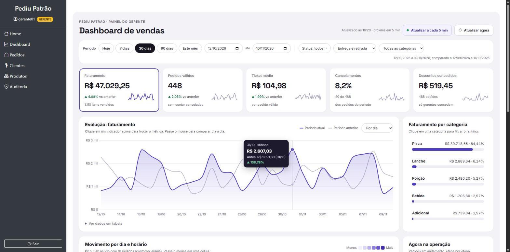
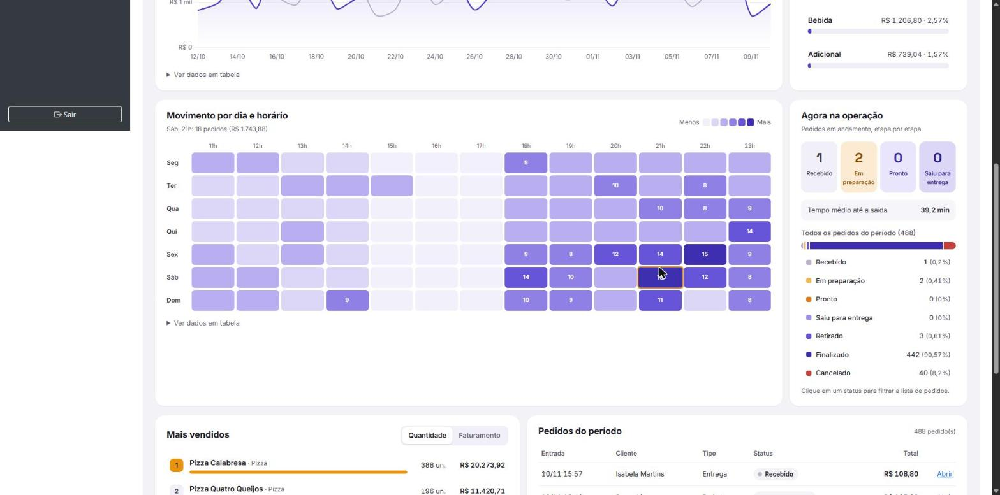
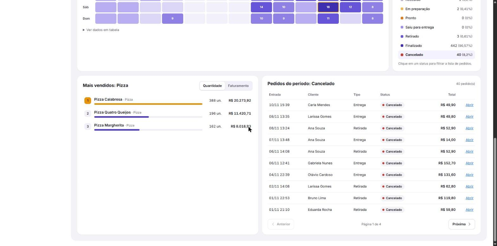
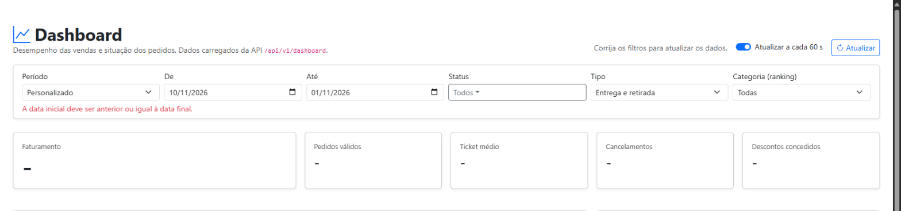
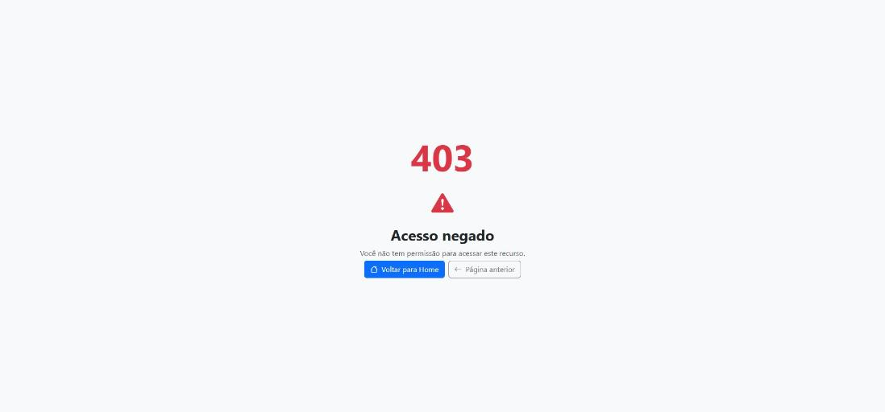

# Evidências de testes - Dashboard Administrativo

Execução de `./mvnw test` em 10/11/2026: **116 testes, 0 falhas, 0 erros, 0 ignorados**.
Destes, **54 são do dashboard** (descritos abaixo); os outros 62 são da etapa anterior (perfis, pedidos e
auditoria) e continuam passando, o que mostra que a nova funcionalidade não quebrou o que já existia.

Os relatórios completos ficam em `target/surefire-reports/` após a execução.

## 1. Estratégia

| Nível | O que garante | Ferramentas |
|-------|---------------|-------------|
| Unidade | Regras dos filtros, cálculo das métricas, preenchimento de intervalos e gerador de dados | JUnit 5, Mockito, AssertJ |
| Integração com o banco | Os pipelines de agregação retornam os números certos no **MongoDB real** | `@DataMongoTest` em banco exclusivo de teste (`pediupatrao_teste_dashboard`) |
| Segurança e contrato HTTP | Quem acessa, códigos de status, formato JSON e mensagens de erro | `@WebMvcTest`, MockMvc, Spring Security Test |
| Ponta a ponta | A aplicação rodando responde a chamadas reais e a tela funciona no navegador | Chamadas HTTP reais ([chamadas-api.md](evidencias/chamadas-api.md)) e capturas de tela |

O teste de integração é ignorado (sem falhar) quando não há MongoDB em `localhost:27017`, para não impedir o build
em máquinas sem banco. Na execução registrada ele **rodou** (11 testes, 0 ignorados).

## 2. Testes automatizados do dashboard

| Classe | Testes | O que verifica |
|--------|--------|----------------|
| `FiltroDashboardTest` | 8 | Período padrão de 30 dias; data só inicial; limites do dia; período invertido e acima de 366 dias recusados; 366 dias aceito; período anterior de mesma duração; status repetidos ignorados. |
| `DashboardServiceTest` | 16 | Faturamento, ticket médio, taxa de cancelamento e variação (inclusive sem base de comparação e período vazio); série diária com dias zerados e descontos; ponto correspondente do período anterior; mapa de calor com as 168 células começando na segunda; semana começando na segunda; série mensal; 24 horas; participação por categoria; todos os status na situação e soma dos em andamento; validação de paginação e do limite do ranking; posições e participação no ranking; opções de filtro. |
| `DashboardRepositoryMongoTest` | 13 | Com pedidos gravados no MongoDB: totais só de vendas; tempo médio até a saída; série por dia e por semana no fuso da aplicação; descontos por dia; mapa de calor por dia da semana e hora sem cancelados; horário ignorando cancelados; valor por status; ranking com **desconto rateado** e categoria buscada no cadastro para itens antigos; filtro por categoria; vendas por categoria; filtros de status e tipo (inclusive `status=CANCELADO` sem faturamento); paginação do mais recente; lista de categorias; pedido do modelo antigo ignorado sem erro. |
| `SegurancaDashboardApiTest` | 11 | Anônimo recebe 401 com desafio Basic; chamada AJAX recebe 401 **sem** o desafio; ATENDENTE recebe 403; GERENTE e ADMIN recebem 200 com envelope `filtros`/`geradoEm`/`dados`; integração por HTTP Basic; POST e DELETE recusados (somente leitura); filtros repassados corretamente ao serviço; período invertido, status inexistente, data mal formatada e agrupamento inválido retornam 400 com o campo `erros`; mapa de calor só para ADMIN e GERENTE. |
| `SegurancaDashboardWebTest` | 4 | Página `/dashboard` abre para GERENTE e ADMIN e carrega o script da API; ATENDENTE recebe 403; sem login redireciona para `/login`. |
| `DemoDataInitializerTest` | 2 | Dados de demonstração coerentes (nenhum pedido no futuro, total = itens - desconto, desconto até 20%, categoria preenchida, saída depois da entrada, há cancelados e em andamento) e reprodutíveis com a mesma semente. |

Exemplo do que o teste de integração confere (valores calculados à mão nos dados do teste):

| Pedido | Itens | Situação | Entra no faturamento |
|--------|-------|----------|----------------------|
| 1 | 2 pizzas (R$ 50) + 1 refrigerante (R$ 10) | Finalizado, saiu em 30 min | R$ 110,00 |
| 2 | 1 pizza com 10% de desconto | Finalizado, saiu em 20 min | R$ 45,00 |
| 3 | 3 pizzas | Cancelado | não |
| 4 | 2 refrigerantes, item sem categoria gravada | Em preparação | R$ 20,00 |
| 5 | 1 pizza | Fora do período | não |

Resultado esperado e obtido: faturamento **R$ 175,00**, descontos R$ 5,00, 6 itens, tempo médio até a saída
**25 min**, pizza com R$ 145,00 no ranking (100 + 45, com o desconto rateado) e o refrigerante classificado como
"Bebida" pelo cadastro de produtos.

## 3. Testes da API rodando (ponta a ponta)

26 chamadas HTTP reais contra a aplicação com cerca de 1.300 pedidos de demonstração: **26 de 26 com o status
esperado**, tempo de resposta das consultas entre 75 e 230 ms. Tabela completa em [evidencias/chamadas-api.md](evidencias/chamadas-api.md).

Resumo dos cenários:

| Cenário | Esperado | Obtido |
|---------|----------|--------|
| Sem credenciais | 401 | 401 |
| ATENDENTE | 403 | 403 |
| ADMIN e GERENTE em todos os 9 endpoints | 200 | 200 |
| ATENDENTE no mapa de calor | 403 | 403 |
| Período invertido, maior que 366 dias, data mal formatada | 400 | 400 |
| Status, agrupamento, página e limite inválidos | 400 | 400 |
| POST e DELETE na API | 403 | 403 |

Conferência de consistência entre endpoints, no mesmo período: o `faturamentoTotal` do ranking (R$ 46.769,77) é
exatamente igual ao faturamento do `/resumo`, e a soma das categorias já arredondadas dá R$ 46.769,76 (diferença de
1 centavo, só de arredondamento). Isso confirma o rateio do desconto entre os itens.

## 4. Testes da interface

Verificados no Chrome com a aplicação rodando:

| Evidência | O que mostra |
|-----------|--------------|
|  | Indicadores com comparativo e mini gráficos, evolução com a linha do período anterior e o quadro do mouse aberto, faturamento por categoria. |
|  | Mapa de calor dia x hora com o pico destacado e o detalhe da célula sob o mouse; pedidos em andamento por etapa e divisão por status. |
|  | Categoria "Pizza" filtrando o ranking e status "Cancelado" filtrando a lista de pedidos. |
|  | Período invertido barrado com mensagem; nenhum dado é carregado. |
|  | ATENDENTE recebe 403 ao abrir `/dashboard`. |

Também verificado manualmente:

- filtros restaurados pela URL (`?periodo=90&tipoEntrega=RETIRADA&agrupamento=SEMANA&ordenarPor=FATURAMENTO`);
- console do navegador sem erros;
- "sem base de comparação" exibido quando o período anterior não tem vendas.

## 5. Como reproduzir

```bash
# testes automatizados (o de integração precisa do MongoDB local)
./mvnw test

# aplicação com dados de demonstração em um banco separado
MONGODB_DATABASE=pediupatrao_demo DEMO_GERAR_DADOS=true ./mvnw spring-boot:run
```

No Windows (PowerShell): `$env:MONGODB_DATABASE="pediupatrao_demo"; $env:DEMO_GERAR_DADOS="true"; .\mvnw.cmd spring-boot:run`.

A especificação [openapi.yaml](openapi.yaml) foi conferida quanto à sintaxe YAML e às referências internas
(9 endpoints, 25 referências, nenhuma quebrada); ela não passou por um validador OpenAPI completo.
