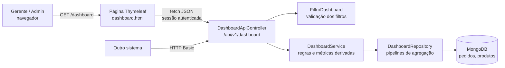

# Dashboard Administrativo - Requisitos e projeto

Documento de análise e projeto do Dashboard Administrativo do Pediu Patrão: requisitos funcionais e não
funcionais, regras de negócio das métricas, modelo de dados utilizado e justificativa das principais decisões.

Documentos relacionados:

- [Documentação dos endpoints](api-dashboard.md) e especificação [OpenAPI](openapi.yaml)
- [Evidências de testes](evidencias-testes.md)

---

## 1. Contexto e objetivo

O responsável pelo estabelecimento precisa acompanhar o desempenho das vendas, a situação dos pedidos e as
tendências da operação para tomar decisões (quais produtos promover, em que horários reforçar a equipe,
se os cancelamentos estão aumentando etc.).

A solução tem duas partes:

1. **API REST de consulta** (`/api/v1/dashboard`), que calcula os indicadores diretamente no MongoDB.
2. **Dashboard web** (`/dashboard`), que consome essa API pelo navegador e apresenta os dados em indicadores,
   gráficos, ranking e tabela.

## 2. Atores

| Ator | Acesso ao dashboard |
|------|---------------------|
| GERENTE | Total (responsável pela operação). |
| ADMIN | Total (consulta). |
| ATENDENTE | Sem acesso: recebe 403 na tela e na API. |
| Sistema externo | Pode consumir a API com HTTP Basic de um usuário ADMIN ou GERENTE. |

---

## 3. Requisitos funcionais

### RF01 - Indicadores gerais de vendas

O dashboard deve exibir, para o período filtrado:

- faturamento, pedidos válidos, ticket médio, taxa de cancelamento, total de descontos e itens vendidos;
- a variação percentual do faturamento, dos pedidos e do ticket médio em relação ao **período anterior de
  mesma duração** (ex.: últimos 30 dias comparados aos 30 dias anteriores).

Critérios de aceitação:

- Os valores são calculados no servidor, a partir dos pedidos gravados.
- Sem vendas no período anterior, a variação aparece como "sem base de comparação" (não há divisão por zero).
- A variação é colorida conforme o sentido: alta de faturamento em verde, queda em vermelho.

Implementação: `GET /api/v1/dashboard/resumo` e os cartões do topo do dashboard.

### RF02 - Análise de vendas (gráficos)

- **Evolução das vendas** em linha, agrupada por dia, semana (começando na segunda-feira) ou mês, com troca entre
  faturamento, quantidade de pedidos e ticket médio.
- **Faturamento por categoria** de produto, em barras horizontais ordenadas.
- **Pedidos por horário** do dia (0h a 23h), com destaque para o horário de pico.

Critérios de aceitação:

- Todo intervalo do período aparece no gráfico, mesmo sem vendas (valor zero), para não esconder dias parados.
- Cada gráfico tem tooltip com o valor exato e uma tabela equivalente ("Ver dados em tabela").
- Nenhum gráfico usa dois eixos verticais: as métricas de escalas diferentes se alternam no mesmo gráfico.

Implementação: `GET /vendas/serie`, `GET /vendas/por-categoria`, `GET /vendas/por-hora`.

### RF03 - Situação dos pedidos

- Quantidade de pedidos em cada status do fluxo (todos os status aparecem, inclusive com zero), pedidos em
  andamento, finalizados, cancelados e o **tempo médio entre a entrada e a saída** do pedido.
- Lista paginada dos pedidos do período, do mais recente para o mais antigo, com acesso ao detalhe do pedido.

Implementação: `GET /pedidos/situacao` e `GET /pedidos`.

### RF04 - Produtos mais vendidos

- Ranking dos produtos ordenável por **quantidade** ou por **faturamento**, com posição, categoria, quantidade,
  faturamento, número de pedidos em que apareceu e participação no faturamento total.
- Pode ser restrito a uma categoria.

Critérios de aceitação:

- Só pedidos não cancelados entram no ranking.
- O desconto do pedido é rateado proporcionalmente entre os itens, então o total do ranking bate com o faturamento.

Implementação: `GET /produtos/ranking`.

### RF05 - Filtros de consulta

- Período (atalhos de hoje, 7, 30 ou 90 dias, mês atual ou datas personalizadas), status (um ou mais), tipo
  (entrega ou retirada) e categoria para o ranking.
- Os filtros ficam numa única linha, valem para todos os painéis e são mantidos na URL: recarregar a página ou
  compartilhar o link reabre a mesma visão.
- A API informa as opções aceitas (status, tipos, categorias, agrupamentos e limites) para que a tela não tenha
  valores fixos no código.

Critérios de aceitação:

- Período com data inicial maior que a final ou com mais de 366 dias é recusado com HTTP 400 e mensagem clara.
- Sem datas, o padrão é os últimos 30 dias até hoje.

Implementação: parâmetros comuns de todos os endpoints e `GET /filtros`.

### RF06 - Integração com a API

- Todo dado exibido no dashboard vem da API REST; a página não recebe dados pelo servidor de páginas.
- A API é independente da tela: pode ser consumida por outro sistema com HTTP Basic.

Implementação: `static/js/dashboard.js` (chamadas `fetch`) e `DashboardApiController`.

### RF07 - Atualização e tratamento de dados

Atualização:

- Atualização automática a cada 5 minutos (pode ser desligada) e botão "Atualizar".
- A atualização automática é pausada com a aba em segundo plano.
- Cada resposta informa `geradoEm` (momento do cálculo), exibido como "Atualizado às ...".

Tratamento de dados no servidor:

- Valores monetários convertidos de forma segura (aceita texto ou decimal; campo ausente ou inválido vale zero).
- Pedidos de modelos antigos, sem data de entrada, ficam fora das análises sem gerar erro.
- Itens antigos sem categoria buscam o tipo no cadastro de produtos ou caem em "Sem categoria".
- Status desconhecidos são ignorados.
- Arredondamento em 2 casas decimais (bancário).

Tratamento na tela:

- Estados de carregando (conteúdo anterior esmaecido, sem piscar), vazio ("Nenhuma venda no período") e erro por
  painel, com botão "Tentar novamente".
- Um painel com erro não impede os demais de carregar.
- Sessão expirada mostra um aviso com link para entrar novamente.

---

## 4. Regras de negócio das métricas

| Código | Regra |
|--------|-------|
| RN01 | **Venda** é todo pedido **não cancelado**, inclusive os que ainda estão em andamento. |
| RN02 | O período considera a **data/hora de entrada** do pedido, de `dataInicio` 00:00 até `dataFim` 23:59:59, no fuso da aplicação. |
| RN03 | **Faturamento** = soma do `valorTotal` (já com desconto) das vendas. |
| RN04 | **Ticket médio** = faturamento / pedidos válidos (zero quando não há pedidos). |
| RN05 | **Taxa de cancelamento** = cancelados / total de pedidos do período x 100. |
| RN06 | **Variação** = (atual - anterior) / anterior x 100; nula quando o anterior é zero. |
| RN07 | **Faturamento por item** = subtotal do item x (100 - % de desconto do pedido) / 100. |
| RN08 | **Tempo até a saída** = média de (saída - entrada) dos pedidos que saíram para entrega ou foram retirados. |
| RN09 | **Em andamento** = Recebido + Em preparação + Pronto + Saiu para entrega. |
| RN10 | O filtro de status vale para todas as métricas; ranking, categorias e horários sempre excluem cancelados. |
| RN11 | Período máximo de 366 dias; página de até 100 pedidos; ranking de 1 a 50 produtos. |

---

## 5. Requisitos não funcionais

| Código | Categoria | Requisito | Como foi atendido |
|--------|-----------|-----------|-------------------|
| RNF01 | Segurança | Acesso exclusivo de ADMIN e GERENTE, aplicado no backend. | Cadeia própria no `SecurityConfig` e `@PreAuthorize` no `DashboardService`; ATENDENTE e anônimo recebem 403/401. |
| RNF02 | Segurança | API somente leitura. | Apenas `GET`; outros métodos recebem 403. |
| RNF03 | Segurança | Autenticação para tela e integração. | Sessão das telas (CSRF continua ativo) e HTTP Basic; a API nunca cria sessão. |
| RNF04 | Segurança | Sem vazamento de dados ou detalhes internos. | Erros em ProblemDetail sem stack trace; textos escapados no navegador (sem XSS); a lista de pedidos expõe só o necessário (sem telefone ou endereço). |
| RNF05 | Desempenho | Respostas abaixo de 1 segundo com milhares de pedidos. | Agregações executadas no MongoDB (só os totais trafegam), índice em `dataHoraEntrada`; medido entre 75 e 260 ms com cerca de 1.300 pedidos ([evidências](evidencias/chamadas-api.md)). |
| RNF06 | Desempenho | Evitar respostas grandes. | Lista de pedidos paginada (máx. 100) e ranking limitado (máx. 50). |
| RNF07 | Confiabilidade | Dados inconsistentes ou antigos não podem derrubar o dashboard. | Conversões seguras no pipeline (`$convert` com padrão), status desconhecidos ignorados, falha isolada por painel. |
| RNF08 | Usabilidade | Leitura rápida dos indicadores. | Faturamento em destaque, comparativo com período nomeado, valores em reais e datas no formato brasileiro, eixos compactos (R$ 10 mil). |
| RNF09 | Acessibilidade | Informação não depende só de cor nem de passar o mouse. | Tabela equivalente em cada gráfico, setas e texto na variação, `aria-label` nos gráficos, status com rótulo. |
| RNF10 | Compatibilidade | Funcionar nos navegadores atuais, também em telas menores. | Bootstrap 5 responsivo e Chart.js 4, versões fixas no CDN. |
| RNF11 | Manutenibilidade | Código em camadas e testável. | Controller, validação de filtros, service com as regras e repository com as consultas; relógio injetável (`Clock`). |
| RNF12 | Testabilidade | Regras verificadas automaticamente. | 111 testes: unidade, segurança (MockMvc) e integração com MongoDB real ([evidências](evidencias-testes.md)). |
| RNF13 | Interoperabilidade | Contrato estável e documentado. | API versionada em `/api/v1`, JSON em camelCase, envelope padrão, especificação OpenAPI 3.1. |
| RNF14 | Portabilidade | Configuração fora do código. | Conexão e senhas em variáveis de ambiente (`.env`); dados de demonstração ligados por `DEMO_GERAR_DADOS`. |

---

## 6. Modelo de dados utilizado

O dashboard **não cria coleções novas**: lê as coleções existentes `pedidos` e `produtos`.

| Coleção / campo | Uso no dashboard |
|-----------------|------------------|
| `pedidos.dataHoraEntrada` (indexado) | Filtro de período, série temporal e horário. |
| `pedidos.status` | Cancelados, situação dos pedidos e filtro de status. |
| `pedidos.tipoEntrega` | Filtro de entrega/retirada. |
| `pedidos.valorTotal`, `valorDesconto`, `percentualDesconto` | Faturamento, descontos e rateio por item. |
| `pedidos.dataHoraSaida` | Tempo médio até a saída. |
| `pedidos.itens[]`: `produtoId`, `nomeProduto`, `categoria`, `quantidade`, `subtotal` | Ranking de produtos e vendas por categoria. |
| `produtos.tipo` | Categoria de itens antigos sem categoria e lista de categorias do filtro. |

Alteração no modelo: `ItemPedido` passou a gravar a **categoria** do produto no momento do pedido, da mesma forma
que já gravava nome e preço, para que mudanças no cadastro não alterem o histórico de vendas.

---

## 7. Decisões de análise e projeto

| Decisão | Justificativa |
|---------|---------------|
| **Agregar no MongoDB** (pipelines `$match`, `$group`, `$facet`, `$dateTrunc`) em vez de carregar os pedidos na aplicação. | O banco filtra e soma e só os totais trafegam; o tempo de resposta não cresce com a memória da aplicação. |
| **Um endpoint por pergunta de negócio** (resumo, série, categoria, hora, situação, ranking, pedidos) em vez de um endpoint único. | Cada painel carrega e falha de forma independente; o filtro de agrupamento ou de ranking recarrega só o seu painel; o contrato fica simples de documentar e de reutilizar. |
| **Versionamento `/api/v1`**. | Permite evoluir o contrato sem quebrar consumidores; as APIs anteriores do projeto foram mantidas sem mudança. |
| **Envelope `{ filtros, geradoEm, dados }`**. | A resposta diz exatamente quais filtros foram aplicados (já com os padrões) e quando os dados foram calculados (RF07). |
| **Filtros validados num único objeto** (`FiltroDashboard`). | A regra do período vale igual para todos os endpoints e é testada isoladamente; a tela valida antes, mas a regra oficial está no backend. |
| **Sessão das telas + HTTP Basic**, sem sessão criada pela API. | A página reutiliza o login já feito; integrações externas não dependem de cookie. O cabeçalho `X-Requested-With` evita a janela de login do navegador quando a sessão expira. |
| **Comparativo com o período anterior de mesma duração**. | Responde à pergunta "estamos vendendo mais ou menos?" sem que o usuário precise montar dois filtros. |
| **Rateio do desconto entre os itens**. | Sem o rateio, a soma do ranking ficaria maior que o faturamento real. |
| **Preencher intervalos sem venda com zero**. | Um gráfico que pula dias parados esconde exatamente o que o gerente precisa ver. |
| **Gráficos de uma cor, destaque só onde importa** (pico de horário) e **sem eixo duplo**. | Leitura mais rápida e honesta; tabela equivalente para acessibilidade. |
| **Gerador de dados de demonstração opcional**, só com banco vazio. | Permite demonstrar tendências (90 dias, fins de semana mais fortes, pico no jantar) sem nunca misturar dados fictícios com reais. |
| **Gitflow**: `feature/dashboard-api`, `feature/dashboard-ui` e `feature/documentacao` integradas em `develop`, `release/2.0.0` publicada em `main` com tag `v2.0.0`. | Histórico separado por responsabilidade e entrega rastreável. |

## 8. Limitações e evoluções possíveis

- Os indicadores são recalculados a cada consulta. Com volume muito maior, caberia cache curto ou coleções de
  totais pré-calculados.
- Não há limitação de taxa (rate limiting) na API; em produção, ela ficaria no gateway ou no proxy.
- O fuso horário é o do servidor; uma configuração explícita evitaria dependência do ambiente.
- Exportação dos dados (CSV/PDF) não foi implementada.
